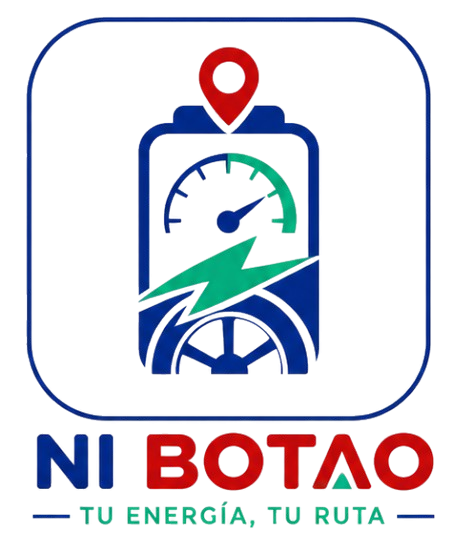
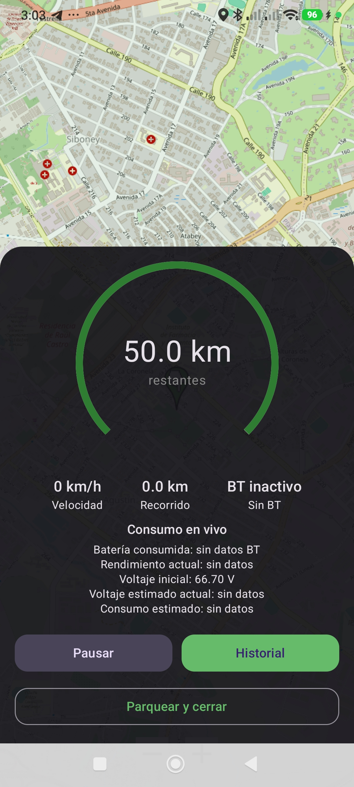
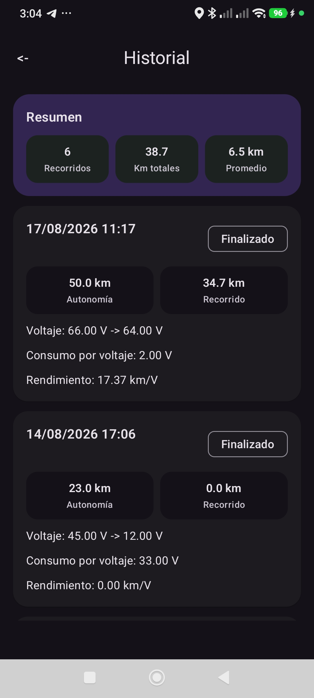

# Ni Botao

<p align="center">
  
</p>

Aplicacion Android (Kotlin + Jetpack Compose) para registrar recorridos, estimar autonomia y visualizar historial con soporte de mapa offline.

> Proyecto preparado para Open Source: documentacion clara, guia de contribucion y flujo automatizado de releases.

## Estado


## Caracteristicas

- Registro de recorridos en tiempo real con servicio foreground.
- Persistencia local con Room.
- Navegacion con Jetpack Compose Navigation.
- Integracion con Bluetooth LE (Android 12+).
- Soporte de mapa offline con OSMDroid.
- Inyeccion de dependencias con Hilt.

## Screenshots

<p align="center">
  
  
</p>

## Stack tecnico

- **Lenguaje:** Kotlin
- **UI:** Jetpack Compose + Material 3
- **Arquitectura:** por capas (`data`, `domain`, `presentation`, `service`)
- **Persistencia:** Room
- **Asincronia:** Coroutines
- **DI:** Hilt
- **Build:** Gradle Kotlin DSL

## Requisitos

- Android Studio (version reciente estable)
- JDK 17 recomendado para AGP 9
- Android SDK con `compileSdk = 35`

## Ejecutar en local

```bash
./gradlew clean
./gradlew assembleDebug
./gradlew testDebugUnitTest
```

El APK de debug queda en `app/build/outputs/apk/debug/`.

## Release automatizado con GitHub Actions

Este repositorio incluye el workflow `/.github/workflows/release.yml` para crear releases automaticamente al subir tags semanticos (`vX.Y.Z`), por ejemplo:

```bash
git tag v1.0.0
git push origin v1.0.0
```

El workflow:

1. Compila `assembleRelease`.
2. Publica una GitHub Release.
3. Adjunta el APK generado como artefacto descargable.

## Buenas practicas Open Source incluidas

- Licencia MIT (`LICENSE`).
- Guia de contribucion (`CONTRIBUTING.md`).
- Politica de seguridad (`SECURITY.md`).
- Codigo de conducta (`CODE_OF_CONDUCT.md`).
- Dependabot para mantener dependencias actualizadas (`.github/dependabot.yml`).

## Como contribuir

Lee `CONTRIBUTING.md` para el flujo recomendado de ramas, PRs y estandares de calidad.

## Roadmap sugerido

- [ ] Agregar tests unitarios para `domain` y `data`.
- [ ] Agregar tests de UI Compose para flujos criticos.
- [ ] Firmado de APK/AAB en CI con secretos de GitHub.
- [ ] Publicacion en Play Store con `fastlane` o `Gradle Play Publisher`.

## Compartir en LinkedIn

Si compartes el proyecto en LinkedIn, puedes usar este formato:

> Hoy publique **Ni Botao** como proyecto Open Source en Android.
> Incluye arquitectura por capas, Compose, Room, Hilt y release automatizado con GitHub Actions.
> Feedback y contribuciones son bienvenidos.

## Seguridad y privacidad

La aplicacion solicita permisos de ubicacion y Bluetooth para funciones de trazado/telemetria. Revisa `SECURITY.md` antes de desplegar en produccion.

## Licencia

Distribuido bajo licencia MIT. Ver `LICENSE`.

